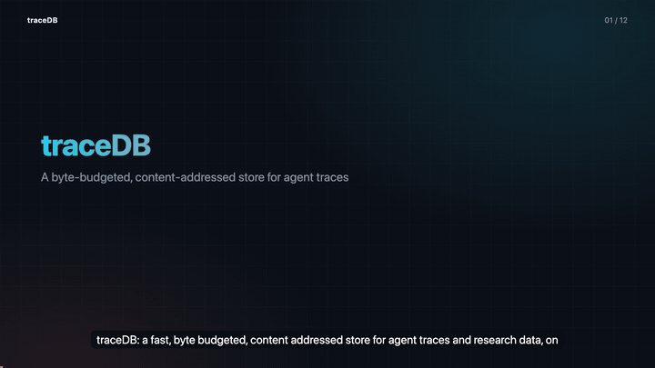
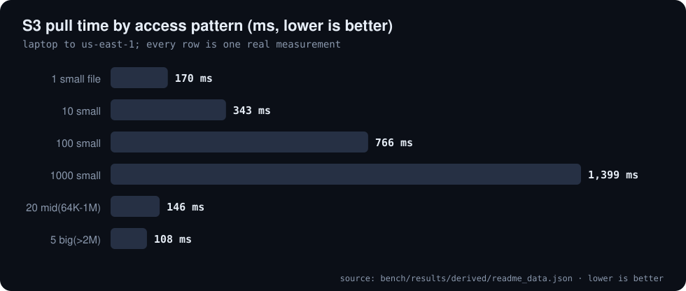
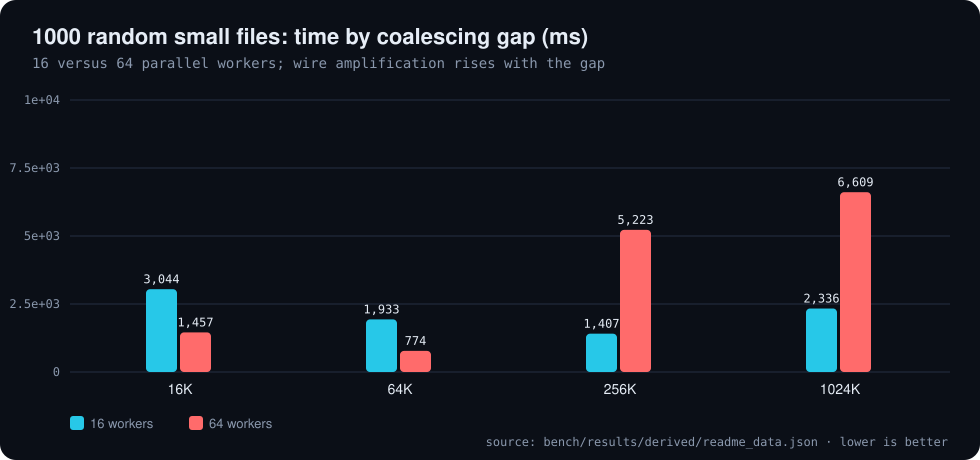
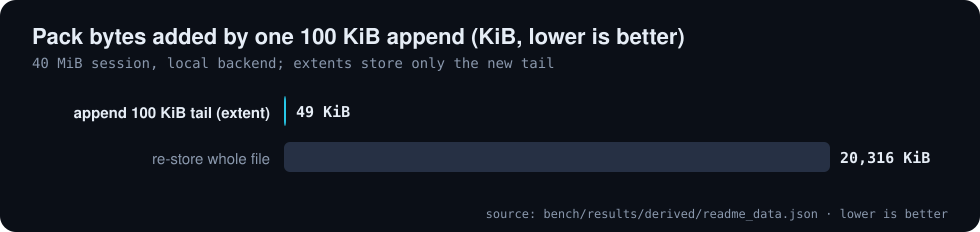
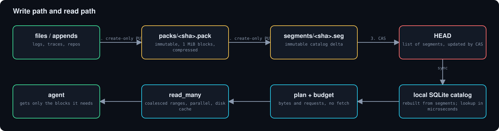
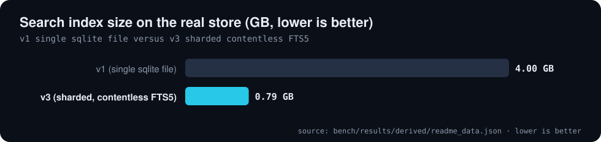

<div align="center">



# 🗄️ traceDB

**A fast, byte-budgeted, content-addressed store for agent traces and research data, over S3 or a local directory**

     [](https://github.com/Bobliuuu/traceDB/releases/tag/v0.3.1) [](https://github.com/Bobliuuu/ontolagni)

[🎬 Video](#video) · [🚀 Quick use](#quick-use) · [📊 Results](#results) · [🧩 How it works](#how-it-works) · [🔎 Search index](#search-index) · [⚠️ Gaps](#caveats) · [🗺️ Repo map](#repo-map)

</div>

---

**Explainer video (with voice-over and subtitles): why traceDB exists, how it stores and reads, and what we measured**

[](video/tracedb_explainer.mp4)

<a id="video"></a>
**traceDB** is a store for agent traces and research data that behaves well when an agent, not a person, is the reader. Many small files are
packed into a few large immutable, content-addressed objects on **S3 (or a local directory)**, a local catalog knows where every byte lives, and
**every read is capped by a byte budget** so an agent can never accidentally pull a 4 GB log into its context.

It pairs with [ontolagni](https://github.com/Bobliuuu/ontolagni): *ontolagni says where data is, traceDB fetches it.*
The design notes are in [DESIGN.md](DESIGN.md); this page summarises what is measured in [`bench/results/`](bench/results).

<a id="quick-use"></a>

## 🚀 Quick use

```bash
export TRACEDB_STORE=s3://bucket/prefix      # or a local dir
tracedb put ./logs --prefix logs/
tracedb locate logs/x/y.jsonl
tracedb plan logs/x/y.jsonl                  # cost, no fetch
tracedb get logs/x/y.jsonl --head 4096       # budgeted (default 8 MiB cap)
```
16 subcommands: `put sync locate ls summary plan get verify compact gc export-catalog blob-put blob-get blob-info search index ...` (see `tracedb --help`).
Pure standard library; `boto3` (S3), `zstandard` and `apsw` (lazy index reads) are optional extras.

<a id="results"></a>

## 📊 Results

All numbers are parsed from the files in [`bench/results/`](bench/results) by [`tools/readme_data.py`](tools/readme_data.py). S3 runs are from a laptop, so about 70 ms of every number is network round trip.

| Files packed | Wire size vs raw | One-file S3 read | No-change sync (one HEAD GET) | Append vs re-store | Index shrink |
|:---:|:---:|:---:|:---:|:---:|:---:|
| **27,646** | **30%** | **170 ms** | **69 ms** | **415x** | **5.1x** |

**Real S3 pulls from a laptop (us-east-1, about 70 ms round trip)**

| Access pattern | Files | Raw MiB | Wire MiB | Requests | Time |
| :--- | ---: | ---: | ---: | ---: | ---: |
| 1 small file | 1 | 0.0 | 0.0 | 1 | 170 ms |
| 10 small | 10 | 0.2 | 0.0 | 10 | 343 ms |
| 100 small | 100 | 0.8 | 2.7 | 79 | 766 ms |
| 1000 small | 1,000 | 7.7 | 49.6 | 162 | 1,399 ms |
| 20 mid(64K-1M) | 20 | 3.5 | 1.0 | 19 | 146 ms |
| 5 big(>2M) | 5 | 16.1 | 2.3 | 4 | 108 ms |

<sub>Source: `bench/results/derived/readme_data.json`</sub>

**1000 random small files: coalescing gap by parallel workers**

| Coalesce gap | Workers | Requests | Read amplification | Time |
| :--- | :--- | ---: | ---: | ---: |
| 16K | 16 workers | 697 | 0.6x | 3,044 ms |
| 64K | 16 workers | 428 | 1.8x | 1,933 ms |
| 256K | 16 workers | 154 | 6.5x | 1,407 ms |
| 1024K | 16 workers | 34 | 14.0x | 2,336 ms |
| 16K | 64 workers | 697 | 0.6x | 1,457 ms |
| 64K | 64 workers | 428 | 1.8x | 774 ms |
| 256K | 64 workers | 154 | 6.5x | 5,223 ms |
| 1024K | 64 workers | 34 | 14.0x | 6,609 ms |

<sub>Source: `bench/results/derived/readme_data.json`</sub>

<p align="center"></p>

<p align="center"></p>

<p align="center"></p>

Whole-directory pulls (what ontolagni points at) cost **one request**. The conditional create-only PUT and the HEAD compare-and-swap were checked on real S3
(a stale etag is refused); 6 concurrent writers lost nothing and a full verify passed. The cold catalog sync of 27,646 entries took 0.88 s.

<a id="append"></a>

## 📈 Append-only growth

An entry is a list of extents laid end to end. When a `put` of a path starts with the stored bytes, only the tail is encoded and stored as a new extent.
40 MiB session plus ten 100 KiB appends adds about 49 KiB of pack per append, against 20,316 KiB to re-store the whole file (415x less), about 51 ms per put (local backend).

<p align="center"></p>

<a id="how-it-works"></a>

## 🧩 How it works

Immutable packs and segments plus one compare-and-swap pointer. Writers never block each other; a CAS loser re-reads HEAD and appends its segment.

<p align="center"></p>

<details>
<summary>Read path in four steps</summary>

1. Local SQLite catalog, rebuilt from segments; `sync` is one HEAD GET plus any unseen segments.
2. `plan` computes raw bytes, wire bytes and requests with zero fetches.
3. `read_many` coalesces ranges, fetches in parallel, caches ranges on disk and decompresses only the blocks needed.
4. Every read is capped (default 8 MiB, `TRACEDB_MAX_BYTES`); over budget raises `BudgetExceeded` with the plan.

</details>

<details>
<summary>What was taken from all-git, and what was dropped</summary>

Took: immutable content-addressed packs with a separate index, create-only and CAS ordering, ranged reads with coalescing, content-keyed cache, compaction from day one. Dropped: sharded manifest and 2PC, locks and merge zones, delta packs, hand-rolled SigV4. Full notes in [DESIGN.md](DESIGN.md).

</details>

<a id="search-index"></a>

## 🔎 Search index v3

`tracedb index build|update|stats` and `tracedb search` build a sharded, contentless FTS5 index *from the store* (not from local source directories), so it always matches what `tracedb get` returns.
Repeated long values are indexed once; `update` adds a delta generation with tombstones; a `--prefix` is an index range scan.
On the real store the index went from **4.0 GB to 0.79 GB** (5.1x smaller, 1,065,173 chunks); a cold first search takes 10.2 s (it was about 4 minutes), warm search without snippets about 24 ms p50.
Recall@10 against the old index is 0.49 (measured on a store that grew by half in between); details in `bench/results/opt-20261111.txt`.

<p align="center"></p>

<a id="quick-start"></a>

## 🚀 Quick start

**Install and run the tests**

```bash
pip install -e '.[s3,zstd,test]'
python3 -m pytest -q
```

**Regenerate this README and video**

```bash
python3 tools/readme_data.py
python3 ~/video-readme-maker/vrm.py all README.spec.yml
```

<a id="new-machine"></a>

## 💻 New machine in one command

One command turns a fresh laptop into a copy of every other machine: every SSH key, the ssh config (every box), every service credential, the Claude Code skills, global CLAUDE.md, settings and memory, and the ontology. Only the AWS sign-in is interactive.

```bash
aws login --profile lab                                    # or a Secrets Manager key: AWS_CRED_SOURCE=secret:<id>
aws s3 cp s3://<bucket>/setup/bootstrap.sh /tmp/b.sh && bash /tmp/b.sh s3://<bucket>/setup
```

`<bucket>/setup/SETUP.md` is the entry point for an agent on a new machine: run the bootstrap, read the ontology, check that everything it lists is installed.
The pieces (all in `tools/`, generic, no hosts or secrets in this repo):

| tool | what |
|---|---|
| `bootstrap.sh` | AWS CLI and venv without sudo, both repos from git bundles in the store, `keys pull`, `skills pull`, ontology, box report. Idempotent; backs up what it replaces to `~/.keys-backup/` |
| `keys.py` (`keys`) | canonical copy in the vault under `keys/` (`keys/MANIFEST.json`: dest, mode, sha256 per file). `status`, `pull`, `push`, `add`, `doctor` (per box: key, reachable, accepted key), `boxes probe` (read-only hardware/status probe into `config/boxes.json`) |
| `skills.py` (`skills`) | every skill variant from `~/.claude/skills` and every repo under `skills/<name>/<variant>/` (secret-bearing files redacted; originals in the vault); the user set installs into `~/.claude/skills` |
| `rebuild_ontology.sh` | rebuild + verify + publish the ontology from any machine (boxes registry, skills, other writers' overlays kept) |
| `publish_setup.sh` | publish `SETUP.md`, `bootstrap.sh`, `bootstrap.env` and source bundles to `<bucket>/setup/` |

Machine auto-syncs write snapshots (`home/ssh/`, ...) to the vault; only `keys` writes `keys/`, so a snapshot can never overwrite the canonical copy. `keys status` reports keys or Host aliases a snapshot has that the canonical copy lacks.

<a id="caveats"></a>

## ⚠️ Honest caveats

- S3 numbers come from a laptop, about 70 ms RTT; a benchmark from inside AWS in the same region is still to do.
- Several runs happened on a loaded machine, so absolute timings vary run to run (the ingest time of a later rerun was much slower than the first).
- Edited (non-prefix) files are stored whole; path overwrite means latest segment wins, with no history API yet.
- Concurrent appenders to the same path: last committed row wins, the other tail is not merged.
- GC is dry-run by default and grace-protected; the touch() race fix is untested on real S3 for the self-copy case, so run GC rarely.
- Search recall against the previous index is 0.49 at ten on the full store (many queries tie and fall back to OR).

<a id="repo-map"></a>

## 🗺️ Repo map

| Path | What it is |
|---|---|
| `tracedb/` | the library and `tracedb` CLI (store, backend, codec, gc, index, search, blob) |
| `tests/` | pytest suite: store, crash safety, append extents, gc and cache, index, search, blobs |
| `bench/` | benchmarks (real S3, local, append, index) and their saved outputs |
| `bench/results/` | the measured result files every number here is parsed from |
| `tools/` | ingest, auto-sync, repo restore and harvest scripts; readme_data.py derives README numbers |
| `DESIGN.md` | full design notes and the measured gaps |
| `README.spec.yml` | drives the README and the video |
| `video/` | explainer mp4, poster, preview gif, subtitles |
| `assets/` | generated hero and chart SVGs |

---

<div align="center"><sub>Generated with [video-readme-maker](https://github.com/Bobliuuu/video-readme-maker).</sub></div>
